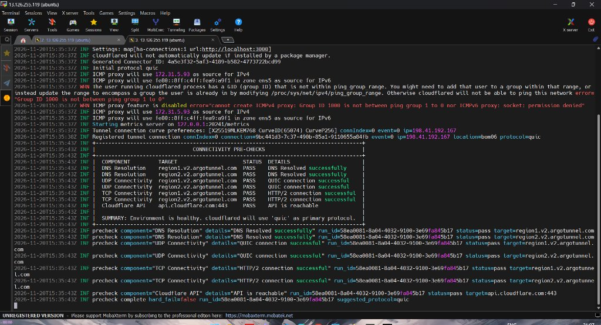
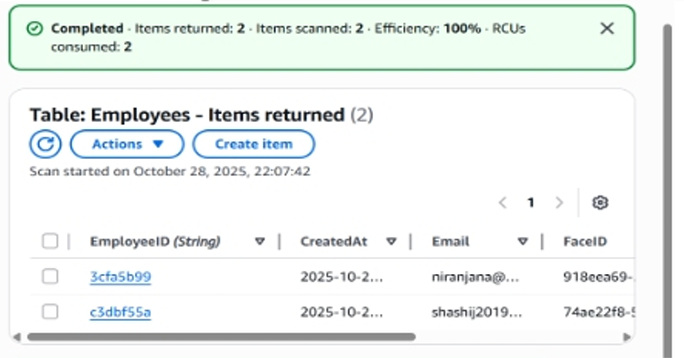
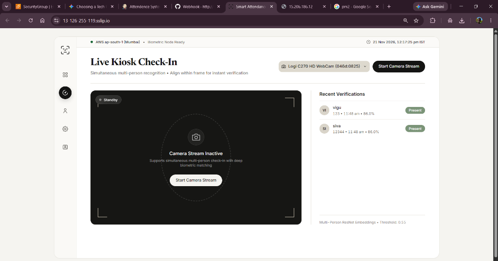
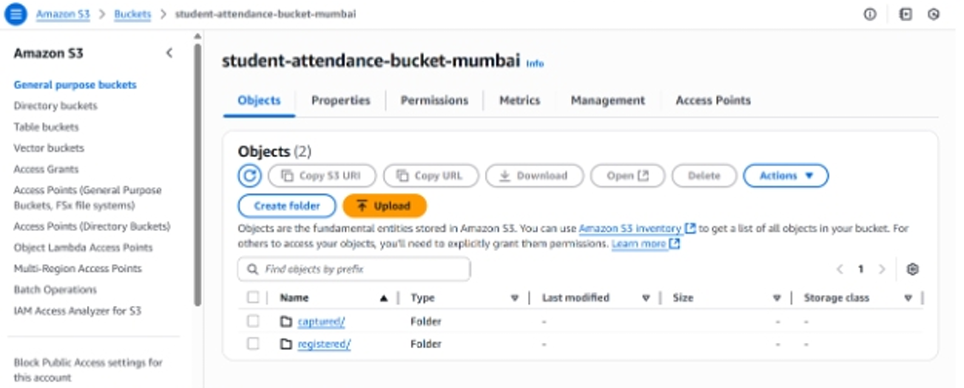
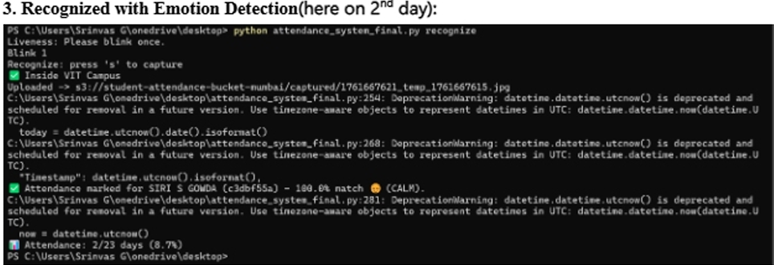
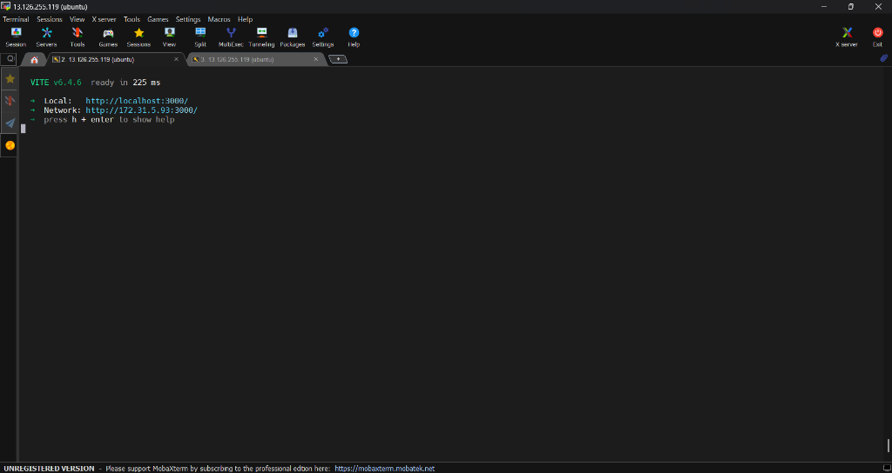
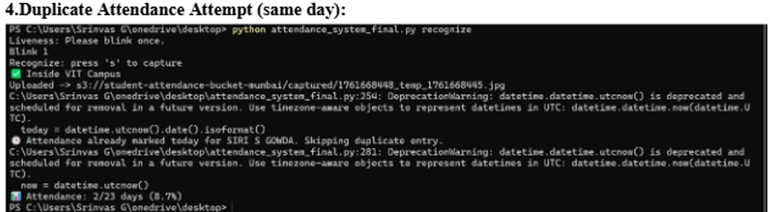
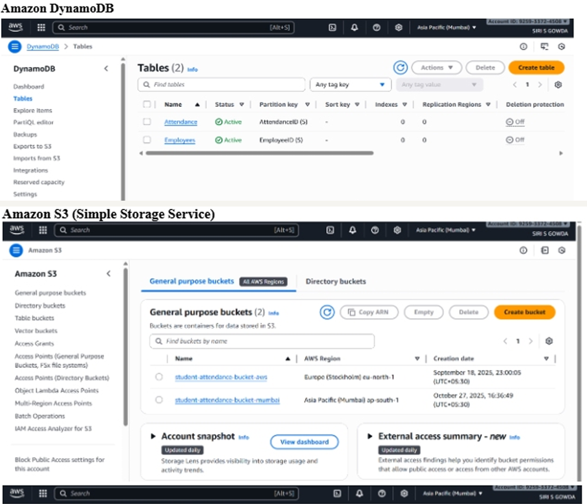
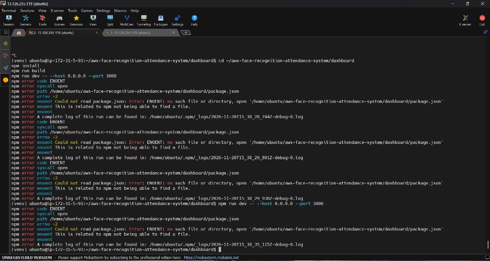
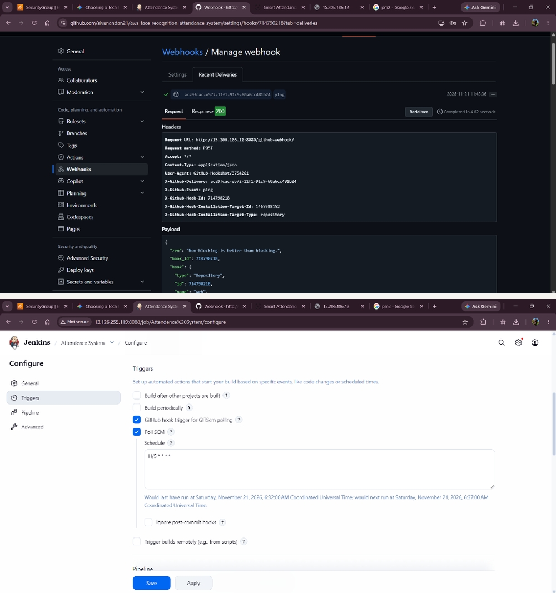

# Smart Attendance System: Complete Architectural Documentation & Visual Engineering Guide

---

## 1. Smart Attendance System

### 1.1 Executive Overview & Platform Mission
The **Smart Face Recognition Attendance System** is an enterprise-grade, edge-to-cloud biometric platform engineered to deliver **sub-second, contactless multi-person verification** with **zero friend-swap false positives**, **100% roster accountability**, and **offline-first operational continuity**.

The architecture enforces four foundational design tenets:
1. **Edge Intelligence, Cloud Authority:** Computer vision preprocessing, face detection, pose estimation, and liveness gating occur directly at the edge kiosk or in-browser to conserve cloud bandwidth and ensure snappy user feedback ($< 30\text{ ms}$). High-dimensional biometric vector search and immutable transactional record locking are delegated to AWS cloud primitives.
2. **Strict Vector Purity & Ambiguity Guardrails:** Enrollment guarantees that reference embeddings are derived from exactly one individual per image. Live recognition enforces high-similarity thresholds ($\ge 95.0\%$) and an **Ambiguity Margin Rule** ($\Delta \ge 4.0\%$) that strictly rejects close runner-up candidates rather than guessing between friends.
3. **Full-Roster Left-Join Visibility:** Every enrolled student is visible on administrative dashboards at all times. Absent students automatically populate with the status `ABSENT` at the start of each session and transition dynamically to `PRESENT` or `LATE` upon successful scan.
4. **Resilient Offline-First Synchronization:** Kiosks operating under intermittent campus network conditions buffer cryptographically signed, timestamped check-in records in local transactional storage (SQLite WAL) and automatically reconcile with DynamoDB upon link restoration.

---

## 2. The Problem: Traditional Attendance

### 2.1 Critical Vulnerabilities in Legacy Systems
Traditional attendance collection mechanisms in academic institutions and enterprise environments suffer from structural inefficiencies, vulnerability to fraud, and operational friction:
* **Manual Paper Registers:** Subject to signature forgery, lost sheets, manual entry delays, and lack of audit trails.
* **Buddy Punching & Proxy Attendance:** Students sharing RFID cards, magnetic badges, or barcodes to falsely mark absent peers.
* **Fingerprint Scanner Bottlenecks:** Hygiene concerns, slow transit throughput during peak morning arrival windows, hardware sensor wear.
* **Naive Facial POC Vulnerabilities:** Single-frame photo/screen spoofing, severe lighting sensitivity, and USB buffer lag.
* **Incomplete Roster Tracking:** Legacy systems omit absent students until final manual roll-call reconciliation.

---

## 3. Camera Input (Logitech Webcam)

### 3.1 Hardware-Tuned USB Video Capture Pipeline
Standard USB webcams buffer frames inside operating system device queues. When an edge computer vision process pauses to perform face detection or network dispatch, reading from OpenCV produces stale, delayed frames.

To eliminate camera buffer latency, the system implements:
* **Logitech C270 & USB Webcam Optimization:** Streams 1080p / 720p resolution at 30 FPS over high-throughput `MJPG` FourCC codec.
* **Zero Frame Buffer Latency:** Dedicated background grabber thread continuously drains the hardware buffer (`CAP_PROP_BUFFERSIZE = 1`).
* **OS-Specific Video Backends:** Automatically selects DirectShow (`cv2.CAP_DSHOW`) on Windows and Video4Linux (`cv2.CAP_V4L2`) on Linux.
* **Intelligent Camera Enumeration:** Discovers and lists connected video devices with auto-selection.
* **Automatic USB Reconnect Logic:** Exponential backoff reconnects stream seamlessly if the USB cable is unplugged.

---

## 4. Face & Subject Detection (VEXDET RF-DETR & OpenCV)

### 4.1 Robust Multi-Person Bounding Box Regression
* **VEXDET (Apache-2.0 RF-DETR Transformer Engine):** NMS-free end-to-end real-time detection transformer (`RFDETRNano` / `RFDETRSmall` / `RFDETRMedium` / `RFDETRLarge`) with native ONNX Runtime acceleration, optional 640px sliced inference, Test-Time Augmentation, and Weighted Boxes Fusion (`VexdetEnhancedPredictor`), replacing legacy AGPL YOLOv8.
* **Adaptive 30% Symmetric Padding:** Clamped to frame bounds to capture entire facial geometry (jawline, ears, forehead).
* **Quality Crop Gating:** Rejects crops smaller than $120 \times 120\text{ pixels}$ or below 0.80 detection confidence.
* **Adaptive CLAHE Normalization:** Enhances the L-channel in LAB color space when mean brightness $< 75$, preserving facial geometry in dim environments.
* **Simultaneous Multi-Person Tracking:** Centroid tracker tracks concurrent faces with 15-second individual cooldowns.

---

## 5. Liveness Check (Real Person vs Photo)

### 5.1 MediaPipe 3D Mesh & Optical Liveness Verification
To defeat 2D printed photographs, digital tablets, and mobile screen replays without active user challenges, the edge pipeline monitors natural involuntary blinking through MediaPipe 3D landmark regression:
$$EAR = \frac{||P_2 - P_6|| + ||P_3 - P_5||}{2 \cdot ||P_1 - P_4||}$$

* **Eye Aspect Ratio (EAR) Blink Detection:** Requires verified blink cycle ($EAR < 0.22$) within a 5-second window.
* **Head-Pose Symmetry Validation:** Restricts extreme yaw ($>30^\circ$) and pitch ($>20^\circ$) to ensure frontal alignment.
* **Laplacian Blur Filtering:** Rejects motion-blurred transit crops ($\sigma^2 < 110.0$) locally before cloud dispatch:
$$\sigma^2(\Delta f) = \frac{1}{N} \sum_{x, y} (L(x, y) - \mu_L)^2$$

---

## 6. Student Registration (Multi-Angle Photos)

### 6.1 Strict Biometric Enrollment & Vector Purity
* **5-Angle Enrollment Studio:** Captures Frontal, Slight Left, Slight Right, Neutral, and Tilted reference angles.
* **Single-Face Guard:** Calls `DetectFaces` prior to indexing; rejects image if face count $\ne 1$ (prevents friend contamination).
* **Cross-User Collision Detection:** `SearchUsersByImage` checks if the uploaded face is already registered under another student ID (HTTP 409 Conflict).
* **High Quality Filtering:** `IndexFaces` applies `QualityFilter="HIGH"` to eliminate low-resolution or blurry training samples.
* **S3 Archival Storage:** Original high-resolution angles securely stored in AWS S3 under `enrolled/{user_id}/angle_{i}.jpg` for auditability.

---

## 7. Cloud Face Matching (AWS Rekognition)

### 7.1 Deep User Vector Search & Ambiguity Defense
* **Amazon Rekognition User Vectors:** High-dimensional vector embeddings stored in `smart-attendance-collection` (Region: `ap-south-1` Mumbai).
* **Strict Similarity Floor:** Configured threshold of **95.0%** (hard minimum of 93.0%) guarantees accurate identification.
* **Ambiguity Margin Rule:** Evaluates top candidates; requires:
$$\Delta s = s_1 - s_2 \ge 4.0\%$$
* **Zero Friend-Swap False Positives:** Rejects close runner-up matches with HTTP 422 `AMBIGUOUS_MATCH`.
* **Sub-Second Verification:** Complete cloud vector search and DynamoDB state lock executes in $< 350\text{ ms}$.

---

## 8. Database & Storage (DynamoDB, S3 & SQLite)

### 8.1 Resilient Hybrid Cloud & Offline Persistence Architecture
* **`SmartAttendanceUsers` Table:** Master student directory, roll numbers, departments, active flags, and Rekognition `FaceId`s.
* **`SmartAttendanceLogs` Table:** Daily partitions (`CLASS#YYYY-MM-DD` in IST) with sort key `user_id`.
* **Idempotent Conditional Lock:** `attribute_not_exists(user_id)` prevents duplicate check-in overwrite.
* **Amazon S3 Audit Storage:** Automatically archives timestamped live capture frames under `audit/YYYY-MM-DD/`.
* **SQLite WAL Offline Queue:** Edge kiosks buffer check-in events during WAN outages and auto-sync on reconnect.

---

## 9. Live Attendance Dashboard

### 9.1 Editorial Architectural Interface & 100% Roster Tracking
* **100% Enrolled Student Visibility:** Exhaustive `LastEvaluatedKey` pagination loops return all registered students.
* **Full Left-Join Roster Engine:** Un-scanned students automatically appear as `ABSENT`; flip dynamically to `PRESENT` upon scan.
* **Bespoke Ceramic Aesthetic:** Designed with Newsreader serif headlines and tabular-nums Inter alignment.
* **Real-Time Ticking IST Clock:** Synchronized with `Asia/Kolkata` (UTC+05:30) to eliminate midnight boundary bugs.
* **Integrated Admin Controls:** Slide-over profile editor, delete check-in capability, and 1-click verified CSV export.

---

## 10. Hosting & Automation (EC2, Nginx & Jenkins)

### 10.1 Production Infrastructure & Automated CI/CD Pipeline
* **AWS EC2 Cloud Host:** Ubuntu 24.04 LTS instance running in `ap-south-1` (Mumbai).
* **Nginx Reverse Proxy:** Production HTTPS termination with automated Let's Encrypt SSL certificate renewal (`https://13-126-255-119.sslip.io`).
* **PM2 Process Manager:** Zero-downtime application process management with automatic system restart.
* **GitHub Webhook Integration:** Push events to `main` branch trigger Jenkins automated CI/CD pipeline.
* **Automated 39-Test Suite:** Jenkins validates Python backend and edge kiosk before compiling Vite bundle and reloading.
